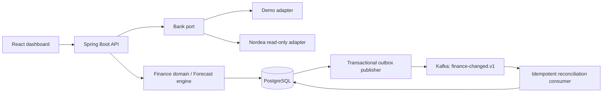

# SME Cash-Flow Copilot

A read-only cash-flow workspace for Finnish small businesses. Spring Boot 3.5 / Java 21,
React / TypeScript, PostgreSQL, Kafka, Docker Compose and Kubernetes.

**Independent prototype, not a Nordea product. No real money moves.**

## What the planning preview does

- Import a bank snapshot and deduplicate transactions.
- Enter customer invoices and planned expenses, or import a CSV atomically.
- Reconcile by unique payment reference and direction, including partial payments.
- Forecast 30, 60 or 90 days with an optional 7/14/30-day customer payment delay.
- Save a clearly labelled planning opening balance without changing bank facts.
- Edit documents and expected payment dates, flag overdue items and cancel unpaid plans.
- Show an explainable shortfall alert, daily movements, source freshness and processing failures.
- Persist financial state in PostgreSQL and process reconciliation asynchronously through Kafka.
- Run immediately with labelled demo data, or configure Nordea's Finnish Instant Reporting sandbox.

Single workspace, one Finnish EUR account, one owner login. No automatic tax calculation,
payment initiation, recurring-expense inference, generative AI, multi-tenancy or production banking.
Cancelled documents remain visible; deletion and reversal of matched payments are not supported.

## Run locally

For a recruiter walkthrough or repeatable synthetic session, use the
[isolated demo guide](docs/demo.md). It starts a credential-free workspace on
**http://localhost:8083**, ignores your `.env`, and offers an explicitly confirmed
reset without touching statement/sandbox data:

```sh
# Node 22.12+ and Docker Compose required for this CLI.
node scripts/demo.mjs up --build
# Later: stop/resume without losing edits.
node scripts/demo.mjs stop
node scripts/demo.mjs up
# Restore the synthetic baseline (deletes ONLY the dedicated demo's data).
node scripts/demo.mjs reset --confirm-reset
```

The original manual startup below remains available on port 8080.

Requires Docker Engine with Compose, approximately 4 GB available memory, and outbound
access to Maven Central, npm and image registries. Java and Node are not required on the host.

```sh
cp .env.example .env
# Optionally change APP_PASSWORD and POSTGRES_PASSWORD before the first start.
docker compose up --build -d --wait
```

Open **http://localhost:8080**. Your browser asks for HTTP Basic credentials:
`developer` / `local-demo-password` by default (or your `.env` values).
If VS Code is connected to this machine over SSH, forward port **8080** from the
Ports panel and open its forwarded address on your own computer.

1. Click **Sync bank account**.
2. Click **Load demo scenario**.
3. Wait until the pending-event indicator disappears (usually a few seconds).
4. Explore the forecast, partial reconciliation and payment-delay scenarios.

The demo has a EUR 12,500 booked balance, two historical matched documents, one
unmatched subscription, and a projected EUR -2,100 minimum. Dates of planned demo
items are relative to the day you load them; bank transaction IDs/dates are fixed
to make repeated syncs idempotent. Historical transactions are already reflected in
the booked balance and are **not** added to it again.

The app is bound to **127.0.0.1**, not a public interface. Do not expose the demo
credentials publicly. Volumes persist across `docker compose down`; restart with
`docker compose up -d`. To stop without removing data:

```sh
docker compose down
```

### Planning scenarios and document changes

Set **Planning opening balance / EUR** and click **Save planning balance** to explore
a realistic SME scenario, even when Nordea's sandbox balance is huge. The override:

- Is saved in PostgreSQL for the workspace and survives reloads, restarts and bank syncs.
- Is visibly labelled **Planning scenario / not a bank balance**.
- Does not change the bank-reported balance, transactions or payment matches.
- Works without a bank connection. Zero and negative opening amounts are valid.
- Can be removed with **Use bank balance** (or **Clear planning balance** if unsynced).

Without either a bank snapshot or an override, the UI does not present the computed
zero-based series as a usable forecast. Setting an override does not synthesize transactions.
Forecasts still use actual matched payments to calculate unpaid document portions.

Use **Edit** on a document to change its details. **Expected payment date** is optional:
the forecast uses that date instead of the due date, then applies the customer-delay
scenario to invoices only. Clearing it restores the due-date assumption. The contractual
due date is preserved, so an unpaid item can remain **Overdue** even with a later expected
date. Document edits are saved workspace-wide, not as multiple independent scenario copies.

Cancellation requires confirmation, is irreversible in this preview, excludes the item
from forecasts/totals and retains it in the document list. Cancelled references cannot
be reused, and cancelled items never match future bank transactions. Documents with
matched payments cannot be cancelled; their type/reference are locked and their amount
cannot be reduced below matched payments. You can still update dates or increase the
amount, preserving existing matches. Corrections involving refunds/reversals need a
future accounting-review workflow.

Edits/cancellation include a revision check. Stale forms receive HTTP 409 instead of
overwriting another session's changes. Close and reopen the form after refreshing.
Reconciliation runs synchronously under the workspace lock before and after lifecycle
changes, so guards also work when Kafka is behind. The same transaction appends an
outbox event; Kafka consumers can replay it idempotently.

#### Try a realistic cash squeeze

In an empty planning workspace, set an opening balance of **EUR 12,000**, then add:

| Kind | Description | Amount | Due |
|---|---|---:|---|
| Expense | Salaries | 9,800 | Today + 5 days |
| Expense | Equipment | 4,800 | Today + 9 days |
| Invoice | Customer project | 8,500 | Today + 14 days |

The minimum becomes **EUR -2,600** on day 9. Edit Equipment's **expected payment date**
to day 20; the minimum becomes **EUR 2,200**. With the customer delay set to seven days,
the shortfall returns because the receipt moves to day 21. These are hypothetical
plans, not bank data or a recommendation to delay contractual payments.
Do not load sample documents over a business's actual plans; use a separate workspace.

### CSV import

See [examples/documents.csv](examples/documents.csv). Exact header:

```csv
kind,counterparty,reference,amount,dueDate
INVOICE,"Example Customer, Oy",30001,2500.00,2026-11-15
EXPENSE,Example Supplier Oy,40001,800.00,2026-11-10
```

UTF-8 RFC4180; at most 200 rows / 256 KB. Positive EUR amounts with at most two
decimal places; ISO dates. Past due dates are allowed. A reference must be unique
across both document types after whitespace removal and uppercasing. The entire
import rolls back on any duplicate or invalid row, including a reference retained by a
cancelled document. The five-column CSV contract is unchanged; set optional expected
payment dates through Edit after import.

## Nordea sandbox setup

See [the sandbox integration guide](docs/nordea-sandbox.md).

The application does not ask you to paste secrets into the UI, source code or chat.
It reads ignored local files on each sync, so you can replace an expired access token
without rebuilding. Automated tests use a local HTTP server for authentication-header,
parsing, pagination and upstream-error cases; a user's first authenticated sandbox sync
remains an onboarding verification step.

Demo, Nordea and statement modes cannot share a workspace database. To preserve your demo while
starting an independent sandbox workspace:

```sh
docker compose down
# Set BANK_MODE=nordea and configure credentials in .env / secrets/.
# A distinct project name gives the new workspace separate database and Kafka volumes.
docker compose -p sme-cashflow-sandbox up --build -d --wait
```

Stop one workspace before starting the other on the same APP_PORT. Mode and account
changes are guarded server-side. Do not delete a database just to switch accounts.

## Bank-statement CSV workspace

Statement mode is an **isolated, user-uploaded EUR account**, not another Nordea
connection. It uses the same documents, forecast engine, transactional outbox and Kafka
reconciliation as bank mode. Uploaded facts are labelled **not bank-verified**.
Bank sync and demo seeding are disabled server-side; statement import is rejected
in demo/Nordea workspaces. There is no in-app workspace switching.

Keep your Nordea workspace on port 8080 and start a separate statement workspace:

```sh
docker compose -p sme-cashflow-statements -f compose.yaml -f compose.statement.yaml up --build -d --wait
# Open http://localhost:8081 using your configured APP_USER / APP_PASSWORD.
```

Always include **`-p sme-cashflow-statements -f compose.yaml -f compose.statement.yaml`**
when operating this workspace, especially if your ignored `.env` sets
`COMPOSE_PROJECT_NAME` to your Nordea project. The override pins statement mode,
uses independent project-scoped PostgreSQL/Kafka volumes, binds only to localhost
and does **not mount Nordea credential files**. Your `.env` and Nordea containers
are not changed. Override `STATEMENT_APP_PORT` if 8081 is occupied. A recent Docker
Compose supporting `!override` and `!reset` is required (2.24.4+).

### Preview, then confirm

1. Choose a stable local account ID (for example `company-eur`) and account name.
   The first confirmed import binds this database to that ID. It is not a bank
   authorization or proof that you own an account.
2. Enter the statement's **closing balance and closing date**, not its balance
   before the listed transactions. Zero/negative closing balances are valid.
3. Upload a UTF-8 RFC4180 CSV using this exact header:

   ```csv
   transactionId,bookingDate,amount,reference,counterparty
   receipt-1,2026-10-28,400.00,STMT-INV,Example Customer Oy
   rent-1,2026-10-28,-200.00,STMT-RENT,Example Landlord Oy
   subscription-1,2026-10-28,-89.00,,Example Software Oy
   ```

4. Click **Preview statement**. Review every row's **New** or **Duplicate / skip**
   status, the account, closing balance/date and counts. No financial data is saved.
   Editing the inputs invalidates the preview; **Discard preview** saves nothing.
5. Confirm that the closing balance already includes the booked payments, then
   click **Confirm statement import**. All new rows, the balance and an outbox event
   are saved atomically. Wait for pending Kafka reconciliation events to reach zero.
6. Add invoices/expenses with matching references. Full/partial payments reduce
   their unpaid portions; missing references and excessive payments remain **Needs review**.

The supplied [synthetic example](examples/statement.csv) is for a disposable workspace,
not for mixing into your actual business data. With a EUR 5,000 closing balance, an
invoice `STMT-INV` of EUR 1,000 due today + 5 days and expense `STMT-RENT` of EUR 200,
the example receipt matches EUR 400 and rent settles EUR 200. Only the remaining
EUR 600 invoice is forecast: final balance **EUR 5,600**, not EUR 5,711.
Historical transactions are already included in the closing balance and are not added again.

### Import contract and limits

- One EUR account per database. Account IDs use 1–128 ASCII letters/digits or `._:-`.
  This is a normalized format; automatic bank-specific CSV mapping is not included.
- At most 500 rows / 256 KB. Transaction IDs are required (max 128 characters),
  counterparties required (max 160), references optional (max 80). Quote fields
  containing commas. Dates are ISO `YYYY-MM-DD`; amounts are nonzero signed EUR
  decimals, up to 9 integer digits and 2 decimals. No exponents, symbols or grouping
  separators. Positive means incoming, negative means outgoing.
- Use stable transaction IDs from your export; do not generate IDs from row position
  or filename. Identity is account ID + transaction ID. Changing an ID can create
  a duplicate payment: the application cannot infer that two different IDs mean one payment.
- Re-uploading identical IDs/details skips duplicates, including overlapping statements.
  Any stored ID with changed date, amount, reference or counterparty rejects the entire
  file. Repeated IDs within one file are rejected, even if identical.
- No future closing dates, no transaction after its closing date, and no older
  closing balance replacing a newer one. A different balance for the same closing
  date is rejected for review. Later closing dates may replace the balance, retaining
  prior transaction history. The opening balance before the export is unknown, so
  CSV totals are not independently validated against the declared closing balance.
- Confirmation revalidates the file under the workspace lock. A revision from preview
  prevents confirming after another import; HTTP 409 requires a new preview.
- The closing balance becomes today's forecast opening unless a saved planning
  override exists. Imports never overwrite that override. The closing date stays
  visible: activity after that date is unknown, not automatically projected.
- Parsed transactions and balance/date are persisted; the original upload is not
  retained as a file. Real statements contain sensitive information: keep them
  outside the repository and never commit them. This is not a production banking or
  accounting integration; reversals and correcting stored facts require future review tooling.

To stop without losing statement data:

```sh
docker compose -p sme-cashflow-statements -f compose.yaml -f compose.statement.yaml down
```

## Monthly recurring expenses

Open **Monthly recurring expenses → Add monthly expense**. Enter a supplier/description,
positive monthly EUR amount, first due date and optional inclusive last due date.
First due dates must be today or within five years; add historical expenses individually.
Only monthly **expenses** are supported—not recurring invoices, weekly schedules,
automatic tax calculations, or inferred obligations.

- Generation immediately creates ordinary expense documents from the first due date
  through **today + 89 days**, covering the longest forecast horizon. A scheduler extends
  this rolling window every minute and catches up missed months after downtime. Newly
  generated overdue amounts land today in the forecast, like other overdue documents;
  review missed obligations rather than assuming they were paid.
- The original day is retained: January 31 → February 28/29 → March 31. An April 30
  start means May 30, not May 31. An end date includes only occurrences due on/before it.
- Every occurrence has a unique `REC-<rule UUID>-YYYY-MM` reference and a persisted
  rule/month identity. Retries, concurrent generators, restarts, changing due dates
  and cancelling individual occurrences do not generate that month twice.
  Do not reuse the `REC-` reference prefix for unrelated documents.
- A create request includes a client-generated `requestId`. Repeating the same ID/details
  succeeds without creating another rule; different details with that ID return 409.
  Different IDs mean different rules: check for pre-existing plans to avoid modelling
  the same rent/salary twice. There is no semantic duplicate-obligation detection.
- Generated documents are labelled **Monthly occurrence** and use existing edits,
  expected dates, cancellation and payment review. Their type stays EXPENSE. A unique
  real payment reference may be entered per occurrence; a bank's repeated monthly
  reference needs manual linking to the correct occurrence.
- **Stop rule** requires confirmation and a revision. It stops only future generation,
  retaining **all** existing occurrences, including already generated future expenses.
  Cancel unwanted unpaid occurrences individually. Paid cancellation/amount safeguards
  remain enforced. Stop is irreversible in this version; series-wide edits/resume are
  deliberately deferred.
- Generation, cursor updates and an outbox event commit atomically under the workspace
  lock. Reference conflicts roll back the entire generation and scheduled failures
  appear on the dashboard. Resolve conflicting references and allow the next retry.
  Kafka handles payment matching as before; no bank facts or planning override change.
- A rule marked **Fully generated** has reached its end date; its documents are not
  necessarily paid. Stopped/ended rules remain visible for context.

## Explain a cash shortage

**Cash breakdown** shows exact horizon-only totals:

`opening balance + expected receipts - planned expenses = projected closing balance`

These are unpaid active documents scheduled in the selected horizon, after expected-date
and invoice-delay assumptions. The all-dates invoice/outgoing cards can include later
documents and therefore differ. Cancelled and fully paid documents are excluded.
Historical account transactions are already included in the opening balance, not added again.

When a first negative daily closing balance occurs, the explanation shows the balance
before that day, its receipts/outgoings and closing balance. Expand **Documents through
the first shortage** for earlier movements and first-shortage-day documents. This is a
cumulative explanation, not a claim that one invoice alone caused a shortage. **Adjust
expected date** opens the actual document form; edits save workspace-wide and leave the
contractual due date unchanged unless you explicitly edit it.

An already-negative opening is identified separately—even if today's receipts recover
the closing balance. The first-shortage closing balance may differ from the forecast
minimum reached later. These are daily closing projections, not intraday liquidity
guarantees or permission to delay contractual payments. Pending reconciliation can
change the breakdown; without a bank/statement/planning opening, it is not shown as usable.

## Payment reconciliation review

Open **Bank transactions** (or **Statement transactions**) and select **Review**.
Each transaction explains its state: automatic/manual match, missing or unknown
reference, cancelled document, direction mismatch, excess amount, zero amount,
pending reconciliation, or an explicit user decision to keep it unmatched.
An excess amount means the **whole payment** exceeds the current unpaid portion,
including amounts reserved by other payments. References are normalized as before.

### Supported corrections

- **Link payment:** choose one active invoice for an incoming payment, or one
  active expense for an outgoing payment. Only documents with enough unpaid amount
  are offered. The full payment is allocated; a smaller payment partially settles
  the document. Manual linking may override a missing/different bank reference,
  but never changes the imported transaction's reference, amount or date.
- **Remove match:** requires a reason and explicit confirmation. The document's
  paid amount is recalculated. The payment is kept **unmatched by your decision**,
  not silently rematched during the next sync, statement import, document edit or
  Kafka replay. This works for both automatic and manual matches.
- **Resume automatic matching:** explicitly releases that hold and immediately
  reruns reference matching. A match is not guaranteed. To move a currently matched
  payment to another document, remove its existing match first, then link it.

Every correction requires a nonblank reason (at most 500 characters), a preview
and confirmation. **Payment review history** records action, previous/next mode,
previous/next document ID and label snapshot, signed-in username and timestamp.
The actor comes from authentication, not the request body. History is append-only
through the application API, not a tamper-proof regulatory audit log; a database
administrator still controls stored data. Automatic matches are derived and do not
create manual audit entries. Historical labels remain as recorded if a document's
name is edited later.

Corrections reconcile synchronously under the same workspace lock used by imports
and document edits. Manual decisions reserve their document amounts before automatic
matching and survive replay and restarts. A payment revision changes when its
decision or allocated document changes; stale reviews receive HTTP 409 and must be
closed/reopened after refreshing. The dashboard also disables a review when polling
detects that its payment changed. Available amounts are checked again at confirmation,
so two sessions cannot over-allocate a document.

Correction, resulting allocations, audit entry and `PAYMENT_REVIEWED` outbox event
are saved in one transaction. Duplicate event delivery does not repeat the audit
entry. Existing matched-document edit/cancellation safeguards also apply to manual
payments. Forecasts use recalculated **unpaid portions**; balances and historical
transactions are never added again or changed by review.

**Limits:** one whole payment per document allocation; multiple payments may settle
one document. Payment splitting, overpayments, refunds/reversals and deleting
financial facts are not supported. An explicit unmatched hold can increase the
forecast's unpaid receipts/expenses: review these assumptions before relying on it.
Automatic matching still runs asynchronously for ordinary imports/document creation;
wait for pending events to reach zero before trusting totals.

## Architecture



- **Modular monolith with ports and adapters:** the domain is not coupled to Nordea's
  payloads or authentication. The React bundle is served by Spring Boot, same origin.
- **Event-driven processing:** document creation and bank import each commit their
  data and an outbox event in one database transaction.
- **Transactional outbox:** publish only after commit; mark published only after
  Kafka acknowledgement. A crash can publish twice, not lose the event.
- **Idempotent consumer:** `processed_event` and reconciliation commit together.
  PostgreSQL row locks coordinate writes. A session advisory lock prevents overlapping
  bank syncs; HTTP calls have timeouts and are not retried blindly.
- **Query/command separation:** writes are commands; the dashboard computes a
  consistent forecast from current bank, document and allocation state. This is
  **not** full CQRS with a separate projection store, and not event sourcing.
- **At-least-once delivery:** Kafka is not an exactly-once bank integration.
  Topic `cashflow.finance-changed.v1` carries event ID, type and schema version only,
  not credentials, account balances or customer details. The single-workspace key
  preserves ordering. Failed publication stays pending with a visible error.
  Consumer failures retry without silently discarding an event.

Forecasting uses exact decimal arithmetic in Java, with a daily end-of-day model.
The minimum includes the chosen opening balance. Only unpaid active document portions
are future movements. Expected payment dates override due dates for scheduling;
receipts are additionally delayed in scenarios, expenses are not. Past movements land
today. Unentered expenses and uncertain customer payment behaviour are not predicted.
Dates use Europe/Helsinki.

The frontend keeps polling, request ordering, notifications and mutation state in
[`main.tsx`](frontend/src/main.tsx). [`ForecastOverview`](frontend/src/ForecastOverview.tsx)
renders the summary, chart controls and insight; [`ActivityTable`](frontend/src/ActivityTable.tsx)
renders document/payment rows and delegates actions back to the dashboard. Planning,
statement imports, recurring rules and payment review remain focused panels. These
are UI boundaries, not separate services or client-side copies of the forecast engine;
Java remains responsible for forecast scheduling, reconciliation and horizon totals.

Reconciliation matches normalized reference + direction and does not allocate more
than a document's total. It rebuilds deterministically, so documents entered after
a bank sync can still match historical transactions. Overpayments, missing references
and unmatched transactions need review. During Kafka lag, unmatched documents can
temporarily double-count expected cash movements; the dashboard shows pending events.

## Kubernetes / k3s

The [Kustomize manifests](deploy/k8s) are a **single-node development deployment**:
one application, one PostgreSQL and one KRaft Kafka broker, with persistent volumes.
They do not change your current cluster until you explicitly apply them.

```sh
docker compose build app
# For a local k3s node; use your registry instead for a remote/multi-node cluster.
docker save sme-cashflow-copilot:0.1.0 -o /tmp/cashflow-image.tar
sudo k3s ctr images import /tmp/cashflow-image.tar
kubectl apply -f deploy/k8s/namespace.yaml
# .env must contain actual APP_PASSWORD and POSTGRES_PASSWORD values.
kubectl -n sme-cashflow create secret generic cashflow-config --from-env-file=.env
kubectl apply -k deploy/k8s
kubectl -n sme-cashflow rollout status deployment/copilot --timeout=300s
kubectl -n sme-cashflow port-forward service/copilot 8080:8080
```

The examples assume the default `cluster.local` DNS domain and a default storage class
(k3s normally provides local-path storage). For Nordea mode, create `nordea-credentials`
with keys `client-secret` and `access-token` from your local files. The developer
sandbox uses Nordea's sandbox signature marker; no private key is required.
See the integration guide. `cashflow-config` is deliberately not committed.

One application replica is intentional: login/CSRF sessions are in memory. Add shared
sessions or an identity gateway before scaling replicas. No public Ingress is installed.
Application probes expose only health status without financial data.

**Before production:** proper identity/tenant isolation, TLS, managed/replicated
PostgreSQL and Kafka, backups/restores, network policies, Kafka TLS/authentication,
secret management/rotation, consent lifecycle, rate-limit policies, audit retention,
accounting review workflows and Nordea's contractual/regulatory onboarding are required.

## Tests and development

```sh
# Node 22.12+:
cd frontend
npm ci
npm run build
npm test
cd ..

# Java 21 + Maven:
cd backend
mvn -B verify
```

Backend tests include exact forecast thresholds, CSV validation, HTTP signing,
empty continuation pages, repeated cursors, currency errors and token expiry.
Statement tests cover strict UTF-8/CSV limits, read-only previews, duplicate/conflict
handling, source/account isolation, stale confirmations, signed amounts, CSRF,
partial matching and exact forecasts without double-counting historical payments.
Payment-review tests cover reason codes, authenticated audit attribution, manual
priority, unlink/resume, stale and competing corrections, over-allocation prevention,
Kafka replay and protected document edits.
Recurring-expense tests cover short months/leap years, inclusive ends, catch-up,
idempotent/concurrent generation, retained edits/cancellations, paid guards, stopped
rules and explicit atomic generation failures. Forecast tests assert exact horizon
totals and first-shortage explanations, including a negative opening recovered today.
The integration test uses **real PostgreSQL via Testcontainers and embedded Kafka**,
covering persistence, duplicate syncs, event redelivery, full/partial reconciliation,
forecast amounts, planning overrides, expected dates, cancellation, stale-write and
matched-payment guards, authentication, CSRF and validation. Docker must be available;
the integration class explicitly skips when it is not. Unit tests still run during
the application image build.

Without host Java, run the backend suite in Maven's container:

```sh
docker run --rm --network host \
  -v "$PWD/backend:/workspace" \
  -v sme-cashflow-maven:/root/.m2 \
  -v /var/run/docker.sock:/var/run/docker.sock \
  -e TESTCONTAINERS_HOST_OVERRIDE=127.0.0.1 \
  -w /workspace maven:3.9.11-eclipse-temurin-21 mvn -B verify
```

This Linux-specific test command gives the container control over Docker; only use
trusted code. Build outputs may be owned by root when using this command.

With the demo stack running, Node can execute an HTTP smoke test:

```sh
node scripts/smoke.mjs
# Optional: stop/restart this project's Kafka and verify durable outbox recovery.
node scripts/smoke.mjs --kafka-outage
# For non-default credentials:
APP_USER=your-user APP_PASSWORD=your-password node scripts/smoke.mjs
```

It loads the demo if the workspace is empty, verifies duplicate-sync safety, waits
for Kafka reconciliation, and checks exact forecast results. Use a fresh demo
workspace without additional documents. It does not erase existing data.

Browser regression tests exercise a dedicated, seeded demo stack at desktop and mobile
sizes, including sync, payment-delay scenarios, document validation, CSV errors, saved
planning balances, rescheduling, overdue indicators and cancellation. Run the smoke test
first to seed a fresh demo workspace. Browser tests retain their cancelled test document;
do not point them at your Nordea workspace or a demo containing plans you want to keep.

```sh
cd frontend
npx playwright install chromium
npm run test:e2e
# If the dedicated demo stack uses another port:
APP_URL=http://127.0.0.1:8081 npm run test:e2e
```

For statement browser tests, use a **separate disposable statement-mode test stack**;
the tests add synthetic documents/payments and must not run on business data:

```sh
# From repository root; the user statement workspace remains on 8081.
STATEMENT_APP_PORT=8082 docker compose -p sme-cashflow-statement-test \
  -f compose.yaml -f compose.statement.yaml up -d --wait
cd frontend
STATEMENT_E2E=1 APP_URL=http://127.0.0.1:8082 npm run test:e2e
```

Screenshots and failure traces are written to the ignored `frontend/test-results`.

For frontend development: run the backend on port 8080, then `npm run dev` in
`frontend` (Vite proxies `/api`). Sign in to the backend first. The standard
container-served UI is the recommended path for authentication and browser testing.

## Operations and troubleshooting

```sh
docker compose ps
docker compose logs --tail=100 app
docker compose logs --tail=100 kafka
curl -fsS http://localhost:8080/actuator/health/readiness
```

- **Pending events:** inspect Kafka and the app logs. Bank imports and documents remain
  durable during broker outages; processing resumes when Kafka returns.
- **Stale balance:** sync is manual in v0.1, to avoid uncontrolled sandbox requests.
  Data older than 15 minutes is marked stale. Re-sync before trusting a forecast.
- **Nordea HTTP 401/403:** check product subscription, token expiry and account access.
  Leave `NORDEA_PRIVATE_KEY_FILE` empty for the standard developer sandbox flow.
  An upstream failure is shown explicitly; never replaced by demo data.
- **Credential file permission denied:** the application runs as UID/GID 1000. Grant
  that user read access without making the files publicly readable.
- **Mode/account mismatch:** use a separate Compose project/database, preserving the old one.
- **Session token expired:** retry the action to fetch a new CSRF token, or reload and sign in.
- **Port in use:** set `APP_PORT` in `.env`.

## API

All `/api` endpoints require the owner login. Writes also require the CSRF token
and session cookie obtained from `GET /api/csrf`.

| Method | Path | Purpose |
|---|---|---|
| GET | `/api/dashboard?days=30&incomeDelayDays=0` | Snapshot, documents, transactions and daily forecast |
| POST | `/api/documents` | Create invoice/expense |
| PUT | `/api/documents/{id}` | Edit using `{document: {...}, revision: n}` |
| POST | `/api/documents/{id}/cancel` | Cancel using `{revision: n}` |
| PUT | `/api/planning` | Save `{openingBalance: amount}`; `null` clears override |
| POST | `/api/recurring-expenses` | `{requestId, counterparty, amount, firstDueDate, endDate?}`; monthly expenses with idempotent request ID |
| POST | `/api/recurring-expenses/{id}/stop` | `{revision}`; stop generating, retain existing documents |
| POST | `/api/documents/import` | Multipart `file` CSV import |
| POST | `/api/statements/preview` | Statement-only read-only preview; multipart `file`, `accountId`, `accountName`, `closingBalance`, `closingDate` |
| POST | `/api/statements/import` | Same multipart fields plus preview `revision`; atomically import and update closing balance |
| POST | `/api/reconciliation/decisions` | `{accountId, transactionId, action, documentId?, revision, reason}`; action `LINK`, `UNLINK` or `RESUME` |
| GET | `/api/reconciliation/history?accountId=...&transactionId=...` | Manual correction history, newest first; URL-encode identifiers |
| POST | `/api/bank/sync` | Manual read-only sync (disabled in statement mode) |
| POST | `/api/demo/seed` | Load documents into an empty demo workspace only |
| GET | `/api/csrf` | Session-bound write token |

Document input accepts nullable `expectedDate` alongside `dueDate`. Dashboard documents
include `expectedDate`, `cancelled` and `revision`; top-level `planningBalance` is nullable.
Revision increments on edits/cancellation, not on reconciliation. Unknown document IDs
return HTTP 404. Schema migration V2 adds these fields without changing existing records,
balances or allocations. Back up the database before upgrading.
Migration V3 adds statement closing-date/import-revision metadata and permits
statement mode in the workspace constraint. Existing workspace modes, account facts,
documents and allocations are preserved; changing a populated workspace's mode remains forbidden.
The dashboard's `status.statementDate` is nullable outside confirmed statement imports.
Migration V4 adds persistent review decisions and append-only application audit history.
Existing allocations are preserved; payments without a decision default to automatic
matching. Dashboard transactions now include `matchMode` (`AUTO`, `MANUAL`, `EXCLUDED`),
`reviewRevision` and an `explanation` code. A decision needs the current payment revision;
`documentId` is required only for `LINK`, and must be omitted/null for `UNLINK`/`RESUME`.
Unknown payments/history queries return HTTP 404. Bank account balances are unchanged.
Migration V5 adds monthly rules, document occurrence provenance and `status.recurrenceError`.
It does not create rules or modify existing financial facts. Dashboard `recurringExpenses`
includes `nextMonth`, computed `nextDueDate`, stopped state and revision; documents include
nullable `recurringExpenseId`/`occurrenceMonth`. Forecasts include `expectedReceipts`,
positive `plannedOutgoings`, `closingBalance` and nullable `shortfallExplanation`.
The explanation contains date, negative-opening flag, before-day balance, same-day
receipts/outgoings/closing and dated document contributions through that day.

Validation errors return HTTP 400, conflicts 409 and bank integration failures 502,
using problem details. Browser/server errors never turn into a successful empty bank sync.