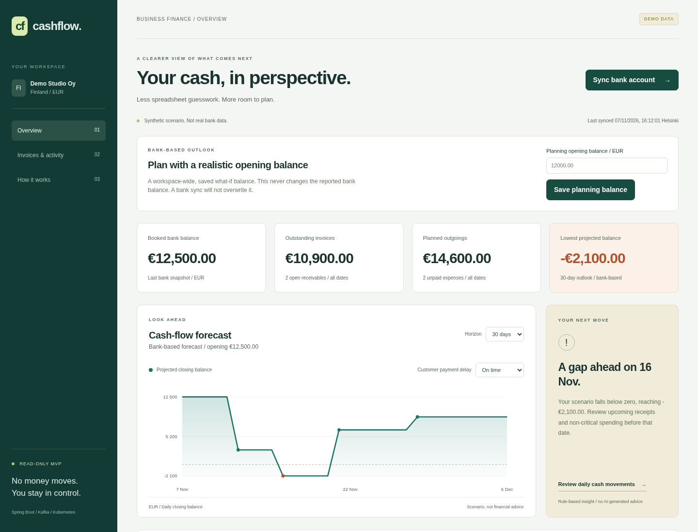
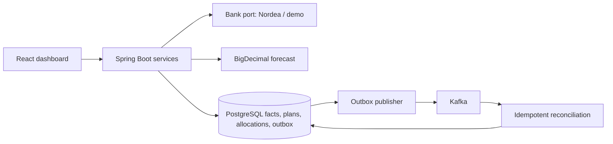

# SME Cash-Flow Copilot

**A positive bank balance today does not mean a small business can pay its bills next week.**
This prototype combines read-only bank information with invoices and planned expenses
to show **when cash may run short, why, and how payment timing changes the outcome**.

Java 21 / Spring Boot · React / TypeScript · PostgreSQL · Kafka · Kubernetes

Independent project, not a Nordea product. No real money moves. "Copilot" means
decision support here: forecasts are deterministic calculations, not generative AI.



*Actual demo UI with synthetic data. Planned dates are relative to the day the demo is seeded.*

## The problem, in numbers

A synthetic business has **EUR 12,500** in its account. That looks comfortable until
upcoming obligations are considered:

| When | Cash movement | Balance |
|---|---|---:|
| Today | Opening booked balance | EUR 12,500 |
| Day +5 | Salaries: EUR -9,800 | EUR 2,700 |
| Day +9 | Equipment: EUR -4,800 | **EUR -2,100** |
| Day +14 | Customer receipt: EUR +8,500 | EUR 6,400 |
| Day +21 | Customer receipt: EUR +2,400 | EUR 8,800 |

**The issue is a timing gap, not necessarily a loss-making business.** The dashboard
explains the first shortage using its contributing documents. Moving the equipment's
expected payment date to day +20 raises the projected minimum to **EUR 2,700**.
If the customer pays seven days late, the shortage returns.

Expected dates are assumptions: they do not change contractual due dates or initiate
payments. Historical payments already included in the opening balance are matched
against documents, **not added to the balance again**.

## What you can do

| Workflow | Outcome |
|---|---|
| Import bank information or preview/confirm a statement CSV | Start with observed balance and transactions; reject duplicate conflicts |
| Add invoices, expenses, and monthly obligations | Build an explicit picture of upcoming cash movements |
| Forecast 30/60/90 days and test customer delays | Understand the size, date, and causes of a projected shortage |
| Save a planning balance or expected dates | Explore assumptions without overwriting bank facts |
| Review a payment and record a reason | Correct matching, retain an audit history, and avoid counting settled plans |

Monthly rules create ordinary editable expenses. Stopping a rule retains generated
obligations. Manual payment decisions take priority over automatic reference matching;
unlinking holds a payment unmatched until explicitly resumed or linked.

## Try it locally

Requires **Node 22.12+, Docker Engine with modern Compose, about 4 GB free memory**,
and internet access for the first build. From the repository root:

```sh
node scripts/demo.mjs up --build
```

Open **http://localhost:8083** with **developer / local-demo-password**.
Wait for `Demo ready`; with remote VS Code, forward port 8083.
No bank credentials, portal subscription, or `.env` needed.

The demo starts with six documents and three historical transactions, including two
matched payments and an unmatched subscription. Planned dates are relative to the
Helsinki day the scenario is seeded.

```sh
node scripts/demo.mjs verify                 # Check the clean baseline
node scripts/demo.mjs stop                   # Keep data for later
node scripts/demo.mjs up                     # Resume
node scripts/demo.mjs reset --confirm-reset  # Delete ONLY dedicated demo data
```

The demo uses separate volumes from statement/sandbox workspaces. Never store real
business data in it or expose its known credentials publicly. Verification syncs
synthetic facts; reset after edits before expecting baseline totals.

## Nordea API integration

The project implements a read-only adapter for **Nordea's Finnish Instant Reporting
sandbox** to fetch account information and transaction history. The same application
can run with synthetic data or user-uploaded statements in separate workspaces.
Failures are shown explicitly, never replaced with successful-looking demo data.

The API supplies **observed information**; future obligations come from entered
documents. A bank integration port keeps Nordea payloads/authentication outside the
forecast engine. Production API access requires Nordea agreements and onboarding;
sandbox fixtures are not evidence of access to a real customer's account.
See [sandbox configuration and verification limits](docs/nordea-sandbox.md).

## Architecture and engineering decisions



| Decision | Why it matters |
|---|---|
| **One deployable, logical service boundaries** | Keeps financial transactions simple; avoids unnecessary microservice coordination |
| **Facts + outbox in one transaction** | A broker outage does not lose an accepted financial change |
| **Processed ID + reconciliation in one transaction** | Duplicate delivery and retries cannot process the same event twice |
| **Decimal arithmetic and explicit assumptions** | Cash calculations and shortage explanations are inspectable and testable |
| **Synchronous guards for edits and reviews** | Paid-document checks remain safe even while Kafka is behind |
| **Visible queue stages and failures** | Eventual consistency is disclosed rather than presented as fully settled data |

Kafka carries event ID, type, and schema version—not balances or customer details.
Delivery is **at least once**. The database remains authoritative; this is a modular
monolith with a bank port/adapters, **not full CQRS or event sourcing**.
The dashboard computes from current facts and allocations. During reconciliation lag,
settled documents can temporarily appear unpaid; processing diagnostics disclose it.

Kubernetes runs one app replica plus PostgreSQL/Kafka StatefulSets with PVCs. The
deployment was tested on a multi-node Kubernetes cluster. Headless-service DNS supports
Kafka bootstrap; images can be imported into containerd workers or supplied by a private
registry. No public Ingress is installed.

Backups validate the checksum and read every archive entry. Confirmed restore stops the
app, creates a safety backup, restores PostgreSQL, and requeues unprocessed events when
Kafka offsets are ahead. Failed restore attempts trigger rollback. Node-local storage
survives pod restarts, **not node/disk loss**; this is not an HA deployment.

## Verification

### Optional Devbox workflow

Install [Devbox](https://www.jetify.com/docs/devbox/) and run from the repository
root:

```sh
devbox run doctor  # show the Java, Maven, Node and npm versions
devbox run setup   # install frontend dependencies and set up the optional kind lab
devbox run setup-frontend  # install frontend dependencies only
devbox run test    # forecast unit test and frontend unit tests
```

Devbox provides a locked Java 21, Maven and Node 22 toolchain; the exact Java
patch can vary by platform. `setup` replaces `frontend/node_modules` as `npm ci`
normally does. Maven downloads its dependencies when tests first run. These
focused tests need no running services or bank credentials. They do not replace
the PostgreSQL/Kafka integration and browser tests or the Docker demo.

The optional shared kind lab additionally offers `devbox run pull`,
`devbox run deploy-all` and `devbox run deploy sme-cashflow`. It requires
`di-agent` to be checked out as a sibling directory. See its
[workspace lab guide](https://github.com/ChuDucAnh242002/di-agent#shared-devbox-kubernetes-lab)
for prerequisites, synthetic-data and persistence safeguards.

Recorded validation covers **39 backend tests**, **16 frontend unit tests**,
**21 demo browser tests on Kubernetes**, and **9 backup/restore CLI tests**.
Backend integration tests use real PostgreSQL through Testcontainers and embedded Kafka.

- Duplicate bank sync and Kafka redelivery preserve financial results.
- Database failures roll back reconciliation and its processed marker together.
- Broker outage plus app restart retains pending events and recovers automatically.
- PostgreSQL/Kafka pod recreation preserves exact financial-data fingerprints.
- Restoring behind Kafka offsets republishes pending events and drains the backlog.
- Browser tests cover planning, manual review, monthly expenses, errors, keyboard
  focus, sampled text contrast, and 320px layouts.

```sh
# Frontend unit tests and type-check/build:
cd frontend
npm ci
npm test
npm run build
cd ..
# CLI guards and database recovery:
bash -n scripts/k8s-db.sh scripts/ci-compose.sh
node --test scripts/*.test.mjs
# Browser tests against the clean synthetic demo (tests modify demo data):
cd frontend
npx playwright install chromium
APP_URL=http://127.0.0.1:8083 npm run test:e2e
```

With Java 21 and Docker available, run `mvn -B verify` from `backend`.
For container-based backend tests, Kubernetes deployment, and backup commands, see
[the operations reference](docs/reference.md). Test counts describe recorded validation,
not a scalability benchmark or general accessibility certification.

## Scope and limits

**One owner, one workspace, one Finnish EUR account.** No payment initiation,
multi-tenancy, tax calculation, AI prediction, transaction splitting/refunds, or
production banking authorisation. Forecasts depend on complete entered obligations
and assumed customer payments; they are daily closing estimates, not intraday
guarantees or financial advice.

Before production: tenant-aware identity, TLS/Kafka access controls, managed/replicated
storage, encrypted off-site backup retention, monitoring/alerting, and bank onboarding.

## Optional Splunk and Jenkins

A separate synthetic lab exports **only operational queue state and process counters**
to local Splunk HEC. Its dashboard shows backlog, sampled failure/recovery transitions,
and sample freshness without forwarding financial records or raw application logs.
Splunk startup requires your explicit licence review and acceptance.

The Jenkinsfile runs the existing tests and a disposable synthetic deployment, publishes
JUnit reports, and cleans up its own CI volumes. GitHub Actions remains available.
See [setup, dashboard, and validation boundaries](docs/enterprise-tools.md).

### Further detail

The essentials are above; these guides provide implementation and operating detail:

- [Demo walkthrough](docs/demo.md)
- [Architecture, transaction sequence, and source map](docs/architecture.md)
- [Four architecture decision records](docs/decisions.md)
- [Workflows, API contracts, Kubernetes, and recovery](docs/reference.md)
- [Nordea sandbox onboarding](docs/nordea-sandbox.md)

### Reliability and processing diagnostics

[Queue semantics, metrics, and operator recovery](docs/reference.md#reliability-and-processing-diagnostics).
