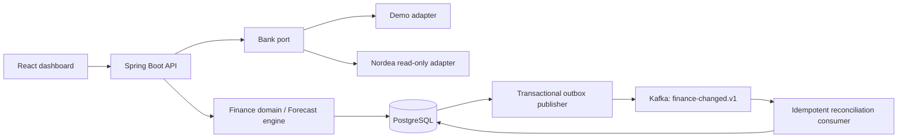

# SME Cash-Flow Copilot

A read-only cash-flow workspace for Finnish small businesses. Spring Boot 3.5 / Java 21,
React / TypeScript, PostgreSQL, Kafka, Docker Compose and Kubernetes.

**Independent prototype, not a Nordea product. No real money moves.**

## What v0.1 does

- Import a bank snapshot and deduplicate transactions.
- Enter customer invoices and planned expenses, or import a CSV atomically.
- Reconcile by unique payment reference and direction, including partial payments.
- Forecast 30, 60 or 90 days with an optional 7/14/30-day customer payment delay.
- Show an explainable shortfall alert, daily movements, source freshness and processing failures.
- Persist financial state in PostgreSQL and process reconciliation asynchronously through Kafka.
- Run immediately with labelled demo data, or configure Nordea's Finnish Instant Reporting sandbox.

Single workspace, one Finnish EUR account, one owner login. No automatic tax calculation,
payment initiation, recurring-expense inference, generative AI, multi-tenancy or production banking.
Documents cannot yet be edited/deleted through the UI; use unique references and check imports carefully.

## Run locally

Requires Docker Engine with Compose, approximately 4 GB available memory, and outbound
access to Maven Central, npm and image registries. Java and Node are not required on the host.

```sh
cp .env.example .env
# Optionally change APP_PASSWORD and POSTGRES_PASSWORD before the first start.
docker compose up --build -d --wait
```

Open **http://localhost:8080**. Your browser asks for HTTP Basic credentials:
`developer` / `local-demo-password` by default (or your `.env` values).
If VS Code is connected to this machine over SSH, forward port **8080** from the
Ports panel and open its forwarded address on your own computer.

1. Click **Sync bank account**.
2. Click **Load demo scenario**.
3. Wait until the pending-event indicator disappears (usually a few seconds).
4. Explore the forecast, partial reconciliation and payment-delay scenarios.

The demo has a EUR 12,500 booked balance, two historical matched documents, one
unmatched subscription, and a projected EUR -2,100 minimum. Dates of planned demo
items are relative to the day you load them; bank transaction IDs/dates are fixed
to make repeated syncs idempotent. Historical transactions are already reflected in
the booked balance and are **not** added to it again.

The app is bound to **127.0.0.1**, not a public interface. Do not expose the demo
credentials publicly. Volumes persist across `docker compose down`; restart with
`docker compose up -d`. To stop without removing data:

```sh
docker compose down
```

### CSV import

See [examples/documents.csv](examples/documents.csv). Exact header:

```csv
kind,counterparty,reference,amount,dueDate
INVOICE,"Example Customer, Oy",30001,2500.00,2026-11-15
EXPENSE,Example Supplier Oy,40001,800.00,2026-11-10
```

UTF-8 RFC4180; at most 200 rows / 256 KB. Positive EUR amounts with at most two
decimal places; ISO dates. Past due dates are allowed. A reference must be unique
across both document types after whitespace removal and uppercasing. The entire
import rolls back on any duplicate or invalid row.

## Nordea sandbox setup

See [the sandbox integration guide](docs/nordea-sandbox.md).

The application does not ask you to paste secrets into the UI, source code or chat.
It reads ignored local files on each sync, so you can replace an expired access token
without rebuilding. **No authenticated call to Nordea has been verified with your
credentials yet**; contract tests exercise signing, parsing, pagination and upstream
errors against a local HTTP server.

Demo and Nordea modes cannot share a populated database. To preserve your demo while
starting an independent sandbox workspace:

```sh
docker compose down
# Set BANK_MODE=nordea and configure credentials in .env / secrets/.
# A distinct project name gives the new workspace separate database and Kafka volumes.
docker compose -p sme-cashflow-sandbox up --build -d --wait
```

Stop one workspace before starting the other on the same APP_PORT. Mode and account
changes are guarded server-side. Do not delete a database just to switch accounts.

## Architecture



- **Modular monolith with ports and adapters:** the domain is not coupled to Nordea's
  payloads or authentication. The React bundle is served by Spring Boot, same origin.
- **Event-driven processing:** document creation and bank import each commit their
  data and an outbox event in one database transaction.
- **Transactional outbox:** publish only after commit; mark published only after
  Kafka acknowledgement. A crash can publish twice, not lose the event.
- **Idempotent consumer:** `processed_event` and reconciliation commit together.
  PostgreSQL row locks coordinate writes. A session advisory lock prevents overlapping
  bank syncs; HTTP calls have timeouts and are not retried blindly.
- **Query/command separation:** writes are commands; the dashboard computes a
  consistent forecast from current bank, document and allocation state. This is
  **not** full CQRS with a separate projection store, and not event sourcing.
- **At-least-once delivery:** Kafka is not an exactly-once bank integration.
  Topic `cashflow.finance-changed.v1` carries event ID, type and schema version only,
  not credentials, account balances or customer details. The single-workspace key
  preserves ordering. Failed publication stays pending with a visible error.
  Consumer failures retry without silently discarding an event.

Forecasting uses exact decimal arithmetic in Java, with a daily end-of-day model.
The minimum includes the opening balance. Only unpaid document portions are future
movements; receipts are delayed in scenarios, expenses are not. Overdue items land
today. Unentered expenses and uncertain customer payment behaviour are not predicted.
Dates use Europe/Helsinki.

Reconciliation matches normalized reference + direction and does not allocate more
than a document's total. It rebuilds deterministically, so documents entered after
a bank sync can still match historical transactions. Overpayments, missing references
and unmatched transactions need review. During Kafka lag, unmatched documents can
temporarily double-count expected cash movements; the dashboard shows pending events.

## Kubernetes / k3s

The [Kustomize manifests](deploy/k8s) are a **single-node development deployment**:
one application, one PostgreSQL and one KRaft Kafka broker, with persistent volumes.
They do not change your current cluster until you explicitly apply them.

```sh
docker compose build app
# For a local k3s node; use your registry instead for a remote/multi-node cluster.
docker save sme-cashflow-copilot:0.1.0 -o /tmp/cashflow-image.tar
sudo k3s ctr images import /tmp/cashflow-image.tar
kubectl apply -f deploy/k8s/namespace.yaml
# .env must contain actual APP_PASSWORD and POSTGRES_PASSWORD values.
kubectl -n sme-cashflow create secret generic cashflow-config --from-env-file=.env
kubectl apply -k deploy/k8s
kubectl -n sme-cashflow rollout status deployment/copilot --timeout=300s
kubectl -n sme-cashflow port-forward service/copilot 8080:8080
```

The examples assume the default `cluster.local` DNS domain and a default storage class
(k3s normally provides local-path storage). For Nordea mode, create `nordea-credentials`
with keys `client-secret` and `access-token` from your local files. The developer
sandbox uses Nordea's sandbox signature marker; no private key is required.
See the integration guide. `cashflow-config` is deliberately not committed.

One application replica is intentional: login/CSRF sessions are in memory. Add shared
sessions or an identity gateway before scaling replicas. No public Ingress is installed.
Application probes expose only health status without financial data.

**Before production:** proper identity/tenant isolation, TLS, managed/replicated
PostgreSQL and Kafka, backups/restores, network policies, Kafka TLS/authentication,
secret management/rotation, consent lifecycle, rate-limit policies, audit retention,
accounting review workflows and Nordea's contractual/regulatory onboarding are required.

## Tests and development

```sh
# Node 22.12+:
cd frontend
npm ci
npm run build
npm test
cd ..

# Java 21 + Maven:
cd backend
mvn -B verify
```

Backend tests include exact forecast thresholds, CSV validation, HTTP signing,
empty continuation pages, repeated cursors, currency errors and token expiry.
The integration test uses **real PostgreSQL via Testcontainers and embedded Kafka**,
covering persistence, duplicate syncs, event redelivery, full/partial reconciliation,
forecast amounts, authentication, CSRF and validation. Docker must be available;
the integration class explicitly skips when it is not. Unit tests still run during
the application image build.

Without host Java, run the backend suite in Maven's container:

```sh
docker run --rm --network host \
  -v "$PWD/backend:/workspace" \
  -v sme-cashflow-maven:/root/.m2 \
  -v /var/run/docker.sock:/var/run/docker.sock \
  -e TESTCONTAINERS_HOST_OVERRIDE=127.0.0.1 \
  -w /workspace maven:3.9.11-eclipse-temurin-21 mvn -B verify
```

This Linux-specific test command gives the container control over Docker; only use
trusted code. Build outputs may be owned by root when using this command.

With the demo stack running, Node can execute an HTTP smoke test:

```sh
node scripts/smoke.mjs
# Optional: stop/restart this project's Kafka and verify durable outbox recovery.
node scripts/smoke.mjs --kafka-outage
# For non-default credentials:
APP_USER=your-user APP_PASSWORD=your-password node scripts/smoke.mjs
```

It loads the demo if the workspace is empty, verifies duplicate-sync safety, waits
for Kafka reconciliation, and checks exact forecast results. Use a fresh demo
workspace without additional documents. It does not erase existing data.

Browser regression tests exercise the running demo stack at desktop and mobile
sizes, including sync, payment-delay scenarios, document validation and CSV errors:

```sh
cd frontend
npx playwright install chromium
npm run test:e2e
```

Screenshots and failure traces are written to the ignored `frontend/test-results`.

For frontend development: run the backend on port 8080, then `npm run dev` in
`frontend` (Vite proxies `/api`). Sign in to the backend first. The standard
container-served UI is the recommended path for authentication and browser testing.

## Operations and troubleshooting

```sh
docker compose ps
docker compose logs --tail=100 app
docker compose logs --tail=100 kafka
curl -fsS http://localhost:8080/actuator/health/readiness
```

- **Pending events:** inspect Kafka and the app logs. Bank imports and documents remain
  durable during broker outages; processing resumes when Kafka returns.
- **Stale balance:** sync is manual in v0.1, to avoid uncontrolled sandbox requests.
  Data older than 15 minutes is marked stale. Re-sync before trusting a forecast.
- **Nordea HTTP 401/403:** check product subscription, token expiry and account access.
  Leave `NORDEA_PRIVATE_KEY_FILE` empty for the standard developer sandbox flow.
  An upstream failure is shown explicitly; never replaced by demo data.
- **Credential file permission denied:** the application runs as UID/GID 1000. Grant
  that user read access without making the files publicly readable.
- **Mode/account mismatch:** use a separate Compose project/database, preserving the old one.
- **Session token expired:** retry the action to fetch a new CSRF token, or reload and sign in.
- **Port in use:** set `APP_PORT` in `.env`.

## API

All `/api` endpoints require the owner login. Writes also require the CSRF token
and session cookie obtained from `GET /api/csrf`.

| Method | Path | Purpose |
|---|---|---|
| GET | `/api/dashboard?days=30&incomeDelayDays=0` | Snapshot, documents, transactions and daily forecast |
| POST | `/api/documents` | Create invoice/expense |
| POST | `/api/documents/import` | Multipart `file` CSV import |
| POST | `/api/bank/sync` | Manual read-only sync |
| POST | `/api/demo/seed` | Load documents into an empty demo workspace only |
| GET | `/api/csrf` | Session-bound write token |

Validation errors return HTTP 400, conflicts 409 and bank integration failures 502,
using problem details. Browser/server errors never turn into a successful empty bank sync.