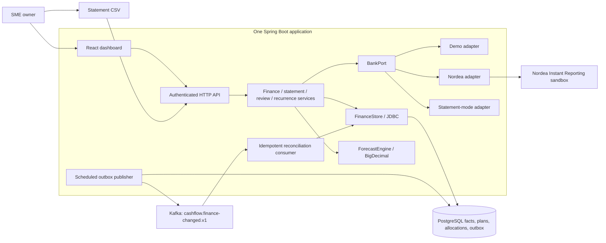

# Architecture

SME Cash-Flow Copilot is a single-workspace, read-only banking and cash-planning
prototype. It keeps observed bank facts separate from user assumptions and makes
reconciliation failures visible. [Decision records](decisions.md) capture the trade-offs;
[the reference](reference.md) documents detailed contracts and operations.

## Components and boundaries



- **Modular monolith:** controllers, services, storage, and calculations share one
  Java package and deployable. These are logical boundaries, not independently
  deployable/enforced modules.
- **Ports/adapters at the bank boundary:** `BankPort.fetch()` returns a common
  snapshot. Nordea payloads and authentication stay in its adapter. Statement CSV
  imports go through a separate preview/confirm service; the statement adapter does
  not fetch a bank feed. This is not a fully persistence-agnostic hexagonal domain:
  application services deliberately share `FinanceStore` and PostgreSQL transactions.
- **Same-origin UI:** Spring Boot serves React and the API. The browser manages forms,
  focus, polling and stale-request ordering; Java owns financial calculations.
- **Authoritative PostgreSQL:** current facts/plans and allocations live in the same
  database. Kafka messages carry `{id, type, schemaVersion}`, not financial payloads.
  They request reconciliation of current state, not replay of historical state.

## A write and its eventual reconciliation

Example: a document is created after its historical bank payment was imported.

```mermaid
sequenceDiagram
    participant UI as React
    participant API as FinanceService
    participant DB as PostgreSQL
    participant P as Outbox publisher
    participant K as Kafka
    participant C as Consumer
    UI->>API: Create document (login + CSRF)
    API->>DB: Lock workspace; insert document + outbox
    DB-->>API: Commit both
    API-->>UI: Created
    P->>DB: Lock committed unpublished outbox rows
    P->>K: Send event ID/type/version
    K-->>P: Broker acknowledgement
    P->>DB: Mark published; commit
    K->>C: Deliver record (may be delivered again)
    C->>DB: Lock workspace; insert processed_event if absent
    C->>DB: For new ID, rebuild allocations; clear recovered failure
    DB-->>C: Commit marker, allocations and diagnostics
    C-->>K: Successful listener processing / offset acknowledgement
    UI->>API: Poll dashboard
    API->>DB: Lock workspace; read facts, plans, allocations
    API-->>UI: Consistent snapshot + computed forecast + queue stages
```

**Failure boundaries:**

| Point of failure | Result |
|---|---|
| Financial write transaction | Facts and event both roll back; no partial import |
| Send failure/timeout | Outbox remains unpublished with a sanitized warning; scheduled retry |
| Broker accepted, app crashed before publish mark | Same ID may publish again; consumer deduplicates |
| Reconciliation/database failure | Allocations and processed marker roll back; record is retried |
| Offset acknowledgement lost after DB commit | Redelivery sees the marker and does not reconcile twice |
| Unsupported/malformed record | Its partition blocks and retries; no automatic discard/skip |

All normal events use the `workspace-1` key on a three-partition topic. Kafka preserves
partition delivery order, but multiple outbox publishers would not guarantee original
command order. The prototype intentionally runs one app replica; events reconcile
current state rather than relying on a complete command history.

New documents/imports can temporarily appear unpaid while Kafka catches up, overstating
future movements already settled in the booked balance. Queue stages disclose that lag.
Document edits/cancellations and manual payment decisions also reconcile **inside the
write transaction**, protecting paid-document and allocation checks even during lag.
Planning-balance updates do not require a reconciliation event.

## Financial and concurrency invariants

1. **Do not count history twice.** The chosen opening is the saved planning override
   or last observed booked/statement balance. Imported payments reduce unpaid document
   amounts; they are never added again to that opening.
2. **Daily, exact decimal forecast.** Active unpaid portions are scheduled on expected
   date or due date. Customer delay applies only to invoices; past movements land
   today. The horizon covers today through `today + days - 1`, using Helsinki dates.
   The minimum includes opening, even if same-day receipts recover a negative opening.
3. **Whole payment, limited capacity.** Automatic matching uses normalized unique
   reference and direction. Manual decisions reserve capacity first. Allocations
   cannot exceed a document total; splitting, overpayments, and refunds are unsupported.
4. **Explicit human corrections.** Unlink persists `EXCLUDED` until explicit resume or
   linking. A review records actor, reason, timestamp and historical document-label
   snapshots. Application audit history is append-only, not DB-admin tamper-proof.
5. **Serialize financial mutations.** A workspace row lock coordinates writes and
   dashboard financial reads. Revisions reject stale edits/reviews. A session advisory
   lock serializes bank sync without holding the financial transaction during HTTP.
6. **One identity/source per workspace.** Persisted mode/account guards reject mixing
   demo, sandbox, or statement facts. Separate databases/volumes are the isolation unit,
   not tenants in one database.
7. **Durable monthly identity.** Rule/month uniqueness and the generation cursor
   commit with generated expense documents and outbox. Original day anchoring handles
   short months; catch-up is supported. Stopping retains every generated occurrence.

## Deployment, health, and recovery

Compose isolates a disposable synthetic demo from user-managed workspaces. Kubernetes
runs one app deployment and single-instance PostgreSQL/Kafka StatefulSets, with two
PVCs and ClusterIP/headless services. Import images into each schedulable containerd
worker or use a private registry. No public Ingress or production Kafka authentication
is installed.

Readiness checks **app + database**, not broker connectivity or bank freshness.
Kafka bootstrap DNS must still resolve at app startup. Persistent queue/failure rows
survive restarts; authenticated Micrometer counters are per-process and reset.
See [diagnostics](reference.md#reliability-and-processing-diagnostics).

An optional, separate synthetic Compose lab uses a polling collector to project
authenticated queue state and process counters into local Splunk HEC. It exports no
financial fields or raw error/log payloads and never participates in writes.
HEC acknowledgement is not a durable audit guarantee; samples may be missing.
An optional Jenkins pipeline verifies an isolated CI deployment without replacing
GitHub Actions. See [setup and validation boundaries](enterprise-tools.md).

Database restore stops writes and creates a private safety backup before replacing
PostgreSQL. It republishes outbox IDs missing processed markers, because existing
Kafka offsets may be ahead of the restored database. Idempotency handles duplicates.
Kafka itself is not backed up by this procedure. Local-path PVCs provide restart
persistence, not node-loss failover; [backup/restore](reference.md#development-backup-and-restore)
is a development runbook, not a production recovery guarantee.

## Source map

| Concern | Entry point |
|---|---|
| Snapshot/writes and synchronous guards | [FinanceService](../backend/src/main/java/fi/cashflow/copilot/FinanceService.java) |
| Bank integration port/adapters | [BankPort](../backend/src/main/java/fi/cashflow/copilot/BankPort.java), [Nordea adapter](../backend/src/main/java/fi/cashflow/copilot/NordeaBankAdapter.java) |
| SQL, reconciliation and queue stages | [FinanceStore](../backend/src/main/java/fi/cashflow/copilot/FinanceStore.java) |
| Publish, deduplicate, retry and metrics | [EventPipeline](../backend/src/main/java/fi/cashflow/copilot/EventPipeline.java) |
| Forecast arithmetic/explanations | [ForecastEngine](../backend/src/main/java/fi/cashflow/copilot/ForecastEngine.java) |
| Manual decisions and audit | [PaymentReviewService](../backend/src/main/java/fi/cashflow/copilot/PaymentReviewService.java) |
| Monthly generation and stop | [RecurringExpenseService](../backend/src/main/java/fi/cashflow/copilot/RecurringExpenseService.java) |
| Statement preview/confirm | [StatementImportService](../backend/src/main/java/fi/cashflow/copilot/StatementImportService.java) |
| Owner login, CSRF and HTTP headers | [WebConfiguration](../backend/src/main/java/fi/cashflow/copilot/WebConfiguration.java) |
| UI orchestration and focused views | [main.tsx](../frontend/src/main.tsx), [ForecastOverview](../frontend/src/ForecastOverview.tsx), [ActivityTable](../frontend/src/ActivityTable.tsx) |
| Persistence history | [Flyway migrations](../backend/src/main/resources/db/migration) |
| Deployment/recovery | [Kubernetes](../deploy/k8s), [demo overlay](../deploy/k8s-demo), [database CLI](../scripts/k8s-db.sh) |

## What this does not establish

No full CQRS, event sourcing, exactly-once bank access, generative AI, payment initiation,
or production Nordea authorization. Tests check specific correctness/recovery/UX paths,
not throughput, multi-tenant isolation, HA, or broad accessibility certification.
Production needs identity/tenant design, TLS and Kafka access controls, managed/replicated
storage, encrypted off-site backups, monitoring/alerting, audit retention, and contractual
bank onboarding. Unentered costs and uncertain customer behavior remain outside the model.
